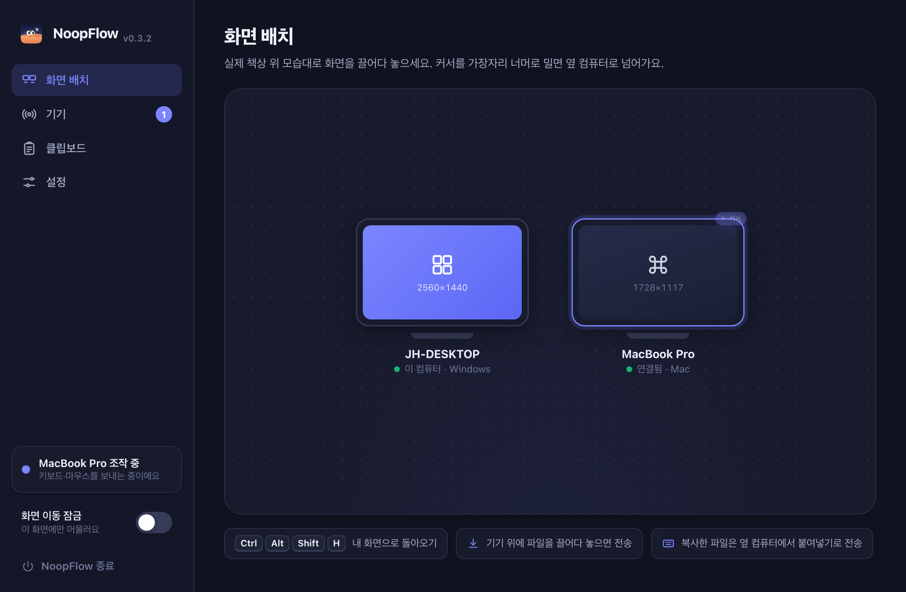
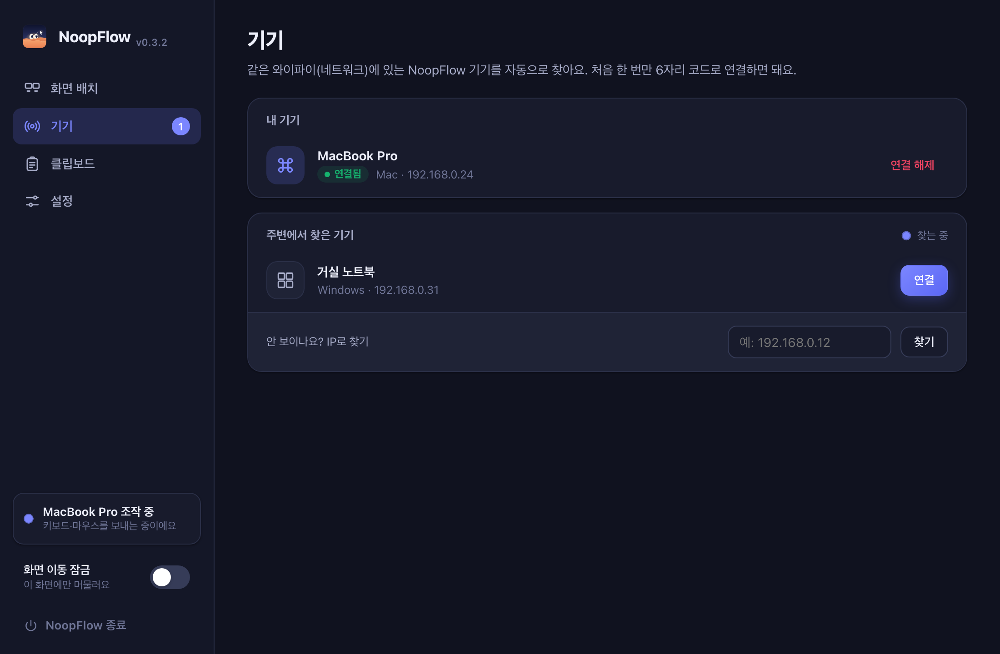
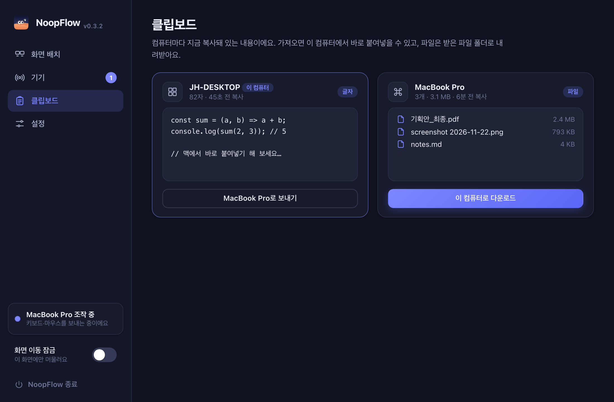
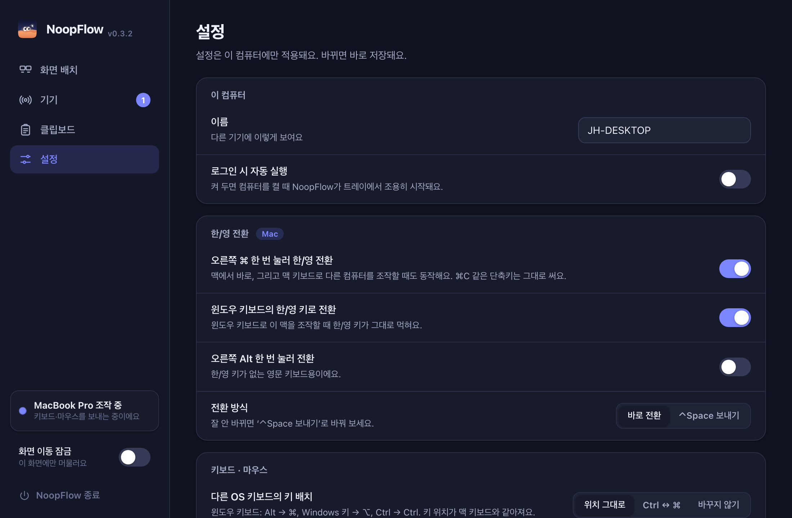
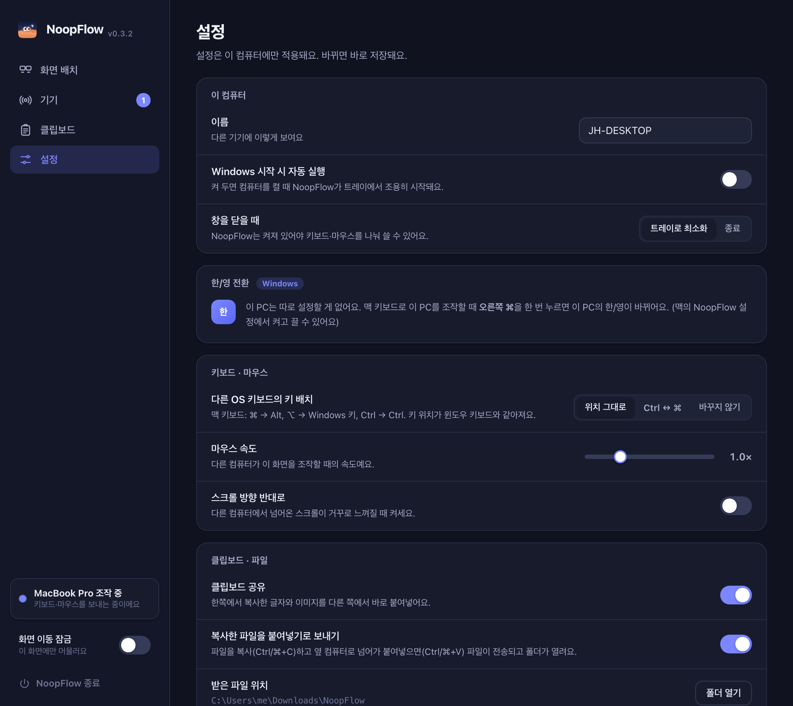
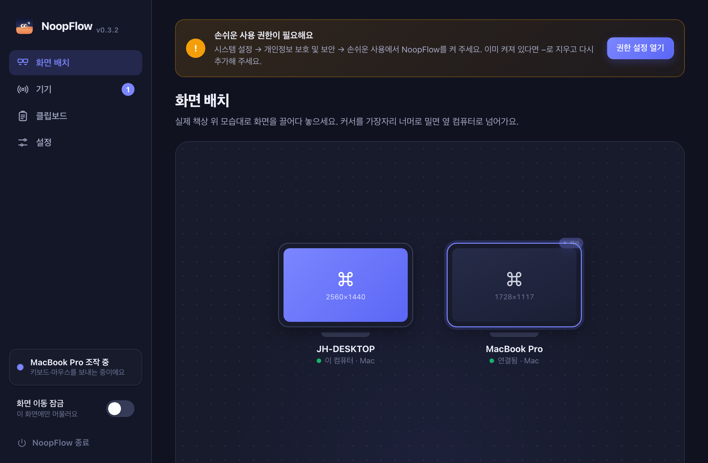

<p align="center">
  
</p>

<h1 align="center">NoopFlow</h1>

<p align="center">
  키보드·마우스 하나로 Windows와 Mac(또는 Windows끼리)을 함께 쓰는 앱이에요.<br />
  커서를 화면 가장자리 너머로 밀면 옆 컴퓨터로 자연스럽게 넘어가요.
</p>

<p align="center">
  <a href="../../releases/latest"><b>최신 버전 다운로드</b></a> ·
  <a href="#주요-기능">주요 기능</a> ·
  <a href="#처음-연결하기">처음 연결하기</a> ·
  <a href="#mac에서-처음-실행할-때">Mac 권한 설정</a> ·
  <a href="https://github.com/sungomi/NooP">NooP 패밀리</a>
</p>

<p align="center">
  
</p>

---

## 다운로드

[Releases](../../releases/latest) 페이지에서 OS에 맞는 설치 파일을 받으면 돼요.

| OS | 설치 파일 | 비고 |
| :--- | :--- | :--- |
| **Windows** | `NoopFlow_x.y.z_x64-setup.exe` (또는 `.msi`) | Windows 10 / 11 (x64) |
| **macOS** | `NoopFlow_x.y.z_universal.dmg` | Apple Silicon · Intel 모두 지원 (macOS 11+) |

> 두 컴퓨터의 NoopFlow 버전이 같아야 해요 (v0.2.0부터 통신 프로토콜이 바뀌었어요). 버전이 다르면 앱에서 바로 알려줘요.

---

## 주요 기능

### 1. 화면 배치 & 부드러운 커서 이동

실제 책상 위 모니터 배치대로 기기 카드를 끌어다 놓으면, 커서를 화면 가장자리 너머로 밀었을 때 옆 컴퓨터로 넘어가요.

- **자유로운 배치**: 좌우·위아래 어느 방향이든 배치할 수 있고, 변경하면 연결된 기기에도 바로 동기화돼요.
- **DPI 배율 보정 & 스무딩**: 125%·150%·Retina 등 화면 배율이 달라도 같은 속도로 부드럽게 움직여요.
- **화면 이동 잠금 & 즉시 복귀**: 왼쪽 아래 **화면 이동 잠금** 스위치로 현재 화면에 고정하거나, 언제든 `Ctrl + Alt + Shift + H`로 내 화면으로 바로 돌아올 수 있어요.
- **다크 / 라이트 모드**: 시스템 테마에 맞춰 자동으로 바뀌어요.

| 다크 모드 | 라이트 모드 |
| :---: | :---: |
|  |  |

---

### 2. 자동 기기 검색 & 6자리 코드 암호화 페어링

같은 네트워크(와이파이·LAN)에 켜져 있는 NoopFlow 기기를 자동으로 찾아요. 처음 한 번만 6자리 코드를 입력해 연결하면 이후에는 자동으로 다시 붙어요.

- **종단간 암호화**: 모든 키보드·마우스·클립보드·파일 전송은 **Noise 프로토콜(X25519 + ChaCha20-Poly1305)** 로 암호화돼요.
- **IP 직접 찾기**: 사내망 등으로 자동 검색이 막혀 있다면 IP 주소를 직접 입력해 찾을 수 있어요.
- **중복 기기 자동 정리**: 재설치 등으로 같은 기기를 다시 페어링해도 예전 오프라인 항목이 남지 않고 기존 화면 위치를 그대로 이어받아요.

| 기기 연결 | 6자리 코드 페어링 |
| :---: | :---: |
|  |  |

---

### 3. 클립보드 공유 & 파일 전송

한쪽에서 복사한 글자와 이미지는 다른 컴퓨터에 자동으로 공유돼요. **클립보드** 탭에서는 연결된 각 컴퓨터에 지금 무엇이 복사돼 있는지 한눈에 보고 원할 때 가져오거나 보낼 수 있어요.

<p align="center">
  
</p>

- **클립보드 미리보기 & 가져오기/보내기**: 텍스트, 이미지 썸네일, 파일 목록을 확인하고 버튼 한 번으로 가져오거나(파일은 다운로드) 다른 기기로 보낼 수 있어요.
- **파일 드래그 앤 드롭**: 화면 배치 탭에서 기기 카드 위에 파일이나 폴더를 끌어다 놓으면 바로 전송돼요.
- **복사 → 붙여넣기 파일 전송**: 파일을 복사(`Ctrl/⌘ + C`)한 뒤 옆 컴퓨터로 넘어가 붙여넣기(`Ctrl/⌘ + V`)하면 파일이 전송되고 저장 폴더가 자동으로 열려요.
- **저장 위치**: 받은 파일은 기본으로 `다운로드/NoopFlow`에 저장돼요.

---

### 4. 한/영 전환 & OS 맞춤 키 배치 · 시스템 설정

Windows와 Mac을 오갈 때 가장 헷갈리는 한/영 전환과 수식키(`Ctrl` / `Alt` / `⌘`)를 자연스럽게 맞춰줘요.

| Mac 설정 (한/영 전환) | Windows 설정 (키 배치 · 마우스 · 클립보드) |
| :---: | :---: |
|  |  |

- **한/영 전환 (Mac ↔ Windows)**
  - **Windows → Mac**: 윈도우 키보드의 `한/영` 키가 맥에서 그대로 먹혀요. (영문 키보드용 `오른쪽 Alt` 탭 옵션도 지원)
  - **Mac → Windows / Mac 로컬**: `오른쪽 ⌘`을 한 번 누르면 한/영이 바뀌어요. `⌘C`, `⌘V` 같은 단축키는 그대로 쓸 수 있어요.
- **OS 간 키 배치 맞춤 (기본: 위치 그대로)**
  - Windows 키보드 → Mac: `Alt → ⌘`, `Windows → ⌥`, `Ctrl → Ctrl`
  - Mac 키보드 → Windows: `⌘ → Alt`, `⌥ → Windows`, `Ctrl → Ctrl`
  - 설정에서 `Ctrl ↔ ⌘` 맞바꾸기 또는 `바꾸지 않기`로 언제든 바꿀 수 있어요.
- **특수키 지원**: `Esc`, `F1~F20`, 볼륨·재생 미디어 키, Mac 실제 Caps Lock 상태 전환까지 모두 넘어가요.
- **트레이 / 메뉴 막대 & 자동 실행**
  - 창을 닫아도 트레이(Windows) 또는 메뉴 막대(Mac)에서 조용히 계속 동작해요.
  - 컴퓨터를 켤 때 자동으로 시작되도록 기본 설정돼 있으며, 설정이나 트레이 메뉴에서 켜고 끌 수 있어요.
  - 완전히 종료하려면 사이드바 왼쪽 아래 **NoopFlow 종료** 버튼이나 트레이 메뉴의 **NoopFlow 종료**를 눌러요.

---

## 처음 연결하기

1. 두 컴퓨터 모두에서 NoopFlow를 실행해요.
2. 한쪽의 **기기** 탭 → **주변에서 찾은 기기** → **연결**을 눌러요.
3. 상대 화면에 뜬 **6자리 코드**를 입력해요.
4. **화면 배치** 탭에서 실제 책상 위 위치대로 맞춰요.

> 기기가 안 보이면 **IP로 찾기**에 상대 IP를 입력해 보세요.  
> 처음 실행할 때 Windows 방화벽 창이 뜨면 **허용**을 눌러야 해요. 사용 포트는 **TCP 47800 / UDP 47801**이며, Deskflow(24800)와 함께 켜져 있어도 충돌하지 않아요.

---

## Mac에서 처음 실행할 때

개인 서명 앱이므로 처음 한 번만 아래 순서대로 권한을 허용해 주세요. 반드시 `.dmg`에서 **응용 프로그램(Applications) 폴더로 옮긴 뒤** 실행해야 권한이 유지돼요.

<p align="center">
  
</p>

1. **보안 경고 통과**: `NoopFlow.app`을 우클릭 → **열기** → **열기**  
   그래도 막히면 터미널에서 `xattr -dr com.apple.quarantine /Applications/NoopFlow.app`을 실행해요.
2. **손쉬운 사용 권한**: 앱 상단 배너의 **권한 설정 열기**를 눌러 NoopFlow를 켜요. 필요하면 **입력 모니터링**도 함께 켜요.
3. **다시 시작**: macOS는 앱을 다시 열어야 새 권한을 적용해요. 배너의 **다시 시작** 버튼을 누르면 끝나요.

> v0.3.0부터 고정 인증서(`NoopFlow Developer`)로 서명해서, 이후 앱을 업데이트해도 손쉬운 사용 권한이 그대로 유지돼요.

---

## 빌드 & 구조

### 직접 빌드하기

준비물: [Rust](https://rustup.rs), Tauri CLI (`cargo install tauri-cli --version "^2" --locked`)

```powershell
# Windows: 개발 실행
cd src-tauri; cargo tauri dev

# Windows: 설치 파일 빌드 (MSI / EXE)
cd src-tauri; cargo tauri build
```

```bash
# macOS (Xcode 명령줄 도구 필요)
bash scripts/build-mac.sh
```

`v`로 시작하는 버전 태그를 push하면 `.github/workflows/build.yml`이 Windows 설치 파일과 macOS 유니버설 `.dmg`를 빌드해 Releases에 자동으로 올려요.

### 프로젝트 구조

```text
core/            Rust 엔진 (UI와 독립)
  engine.rs      컨트롤러/타깃 역할, 화면 전환, 중복 기기 정리, 한/영 탭 감지
  net.rs         Noise 암호화 연결, 6자리 코드 페어링, UDP 자동 검색
  platform/      Windows 훅·SendInput / macOS CGEventTap·CGEventPost·TIS 입력 소스
  keys.rs        Windows 스캔코드·VK ↔ USB HID ↔ Mac 키코드
  clipboard.rs   클립보드 감시, 미리보기, 자동 동기화
  files.rs       파일 전송 (경로 정리, 이름 충돌 처리)
src-tauri/       데스크톱 앱 셸 (트레이, 메뉴 막대, 자동 실행)
ui/              화면 (HTML / CSS / JS, 브라우저 미리보기 모드 지원)
```

---

## 알려진 한계

- **Windows 보안 화면**: UAC 창, 잠금 화면, 관리자 권한으로 실행된 창에는 일반 권한에서 입력이 들어가지 않아요. 관리자 창을 조작해야 한다면 NoopFlow를 관리자 권한으로 실행해 주세요.
- **화면 경계를 넘는 드래그 앤 드롭**: 아직 지원하지 않아요. 화면 배치의 기기 카드에 파일을 끌어다 놓거나, 복사(`Ctrl/⌘ + C`) 후 옆 컴퓨터에서 붙여넣기(`Ctrl/⌘ + V`)로 보내세요.

---

## 제작자

**sungomi** · [github.com/sungomi](https://github.com/sungomi)

라이선스: [MIT License](LICENSE)
