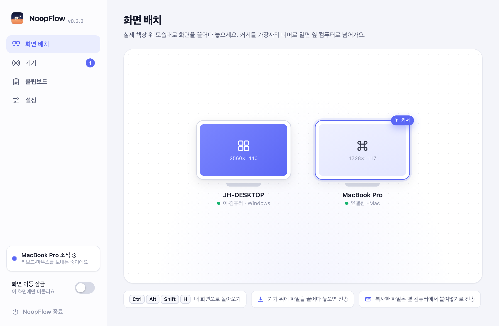

<p align="center">
  
</p>

<h1 align="center">NoopFlow</h1>

<p align="center">
  키보드·마우스 하나로 Windows와 Mac(또는 Windows끼리)을 함께 쓰는 앱이에요.<br />
  커서를 화면 가장자리 너머로 밀면 옆 컴퓨터로 넘어가요.
</p>

<p align="center">
  <a href="../../releases/latest"><b>다운로드</b></a> ·
  <a href="https://github.com/sungomi/NooP">NooP</a> 패밀리
</p>

<p align="center">
  
</p>

> **상태: v0.1 (초기 버전)**. Windows에서는 빌드하고 실행까지 확인했어요. Mac 버전은 아직 실제 Mac에서 돌려보지 않았어요.

## 다운로드

[Releases](../../releases) 페이지에서 받으면 돼요.

- Windows: `NoopFlow_x.y.z_x64-setup.exe` (또는 `.msi`)
- Mac: `NoopFlow_x.y.z_universal.dmg` (Apple Silicon, Intel 모두 지원)

새 버전을 내려면 버전 태그를 push하면 돼요. 그러면 GitHub Actions가 빌드해서 Releases에 자동으로 올려줘요. 평소 push에는 빌드가 돌지 않아요.

```bash
git tag v0.1.1
git push origin v0.1.1
```

## 스크린샷

| 기기 연결 | 6자리 코드 페어링 |
| :---: | :---: |
|  |  |
| **한/영 전환 설정 (Mac)** | **라이트 모드** |
|  |  |

> 스크린샷은 샘플 데이터로 찍은 화면이에요. `scripts/screenshots.ps1`로 다시 찍을 수 있어요.

## 기능

- **화면 배치**: 기기 카드를 끌어서 실제 책상 위 위치대로 놓아요 (좌우·위아래 모두 가능).
- **자동 검색 + 6자리 코드 연결**: 같은 네트워크의 기기를 자동으로 찾아요. 처음 한 번만 코드를 입력하면 돼요.
- **암호화**: 모든 입력은 Noise 프로토콜(X25519 + ChaCha20-Poly1305)로 암호화돼요. 한 번 연결한 기기만 접속할 수 있어요.
- **한/영 전환 (Mac)**
  - 오른쪽 ⌘을 한 번 누르면 한/영이 바뀌어요. ⌘C 같은 단축키는 그대로 써요.
  - 맥 키보드로 윈도우를 조작할 때도 오른쪽 ⌘으로 윈도우의 한/영이 바뀌어요.
  - 윈도우 키보드로 맥을 조작할 때는 한/영 키가 그대로 먹혀요.
  - 영문 키보드라면 오른쪽 Alt로 전환하는 옵션도 있어요.
- **키 배치 맞춤** (기본: 위치 그대로): 윈도우 키보드로 맥을 조작하면 Alt → ⌘, Windows 키 → ⌥, Ctrl → Ctrl로 바뀌어요. 맥 키보드로 윈도우를 조작하면 그 반대예요. 설정에서 'Ctrl ↔ ⌘'나 '바꾸지 않기'를 고를 수도 있어요.
- **부드러운 마우스**: 화면 배율(125%·150% 등)이 달라도 같은 속도로 움직여요. 빠른 마우스의 이동 신호는 묶어서 보내요.
- **클립보드 공유**: 텍스트와 이미지.
- **파일 보내기**
  - 화면 배치에서 기기 카드 위에 파일이나 폴더를 끌어다 놓으면 보내져요.
  - 파일을 복사(Ctrl/⌘+C)하고 옆 컴퓨터로 넘어가서 붙여넣으면(Ctrl/⌘+V) 파일이 전송되고 폴더가 열려요.
  - 받은 파일은 `다운로드/NoopFlow`에 저장돼요.
- **단축키**: `Ctrl+Alt+Shift+H`를 누르면 내 화면으로 바로 돌아와요.
- **트레이 / 메뉴 막대**
  - Windows: 창을 닫으면 '종료 / 최소화 / 취소'를 물어봐요. '다음부터 묻지 않기'를 고를 수 있어요.
  - Mac: 창을 닫으면 메뉴 막대에 남아요. 메뉴 막대 아이콘을 누르면 연결 상태, 화면 이동 잠금, 자동 실행, 설정, 종료 메뉴가 나와요.
- **자동 실행**: 컴퓨터를 켜면 트레이에서 조용히 시작돼요. 처음 설치하면 켜져 있고, 설정이나 트레이 메뉴에서 끌 수 있어요.

> 두 컴퓨터의 NoopFlow 버전이 같아야 해요 (0.2.0부터 통신 방식이 바뀌었어요). 버전이 다르면 앱이 알려줘요.

## 처음 연결하기

1. 두 컴퓨터 모두에서 NoopFlow를 실행해요.
2. 한쪽의 **기기** 탭 → 주변에서 찾은 기기 → **연결**을 눌러요.
3. 상대 화면에 뜬 6자리 코드를 입력해요.
4. **화면 배치**에서 실제 위치대로 맞춰요.

기기가 안 보이면 **IP로 찾기**에 상대 IP를 넣어 보세요.
처음 실행할 때 Windows 방화벽 창이 뜨면 **허용**을 눌러야 해요.
쓰는 포트는 TCP 47800, UDP 47801이에요. Deskflow(24800)와 같이 켜져 있어도 충돌하지 않아요.

## Mac에서 처음 실행할 때

서명이 안 된 개인용 앱이라서 두 가지를 한 번씩 해줘야 해요.

1. **보안 경고 통과**: `NoopFlow.app`을 우클릭 → 열기 → 열기.
   그래도 막히면 터미널에서 `xattr -dr com.apple.quarantine /Applications/NoopFlow.app`을 실행해요.
2. **손쉬운 사용 권한**: 앱 위쪽 배너의 **권한 설정 열기**를 눌러 NoopFlow를 켜요. 필요하면 **입력 모니터링**도 켜요.
3. **다시 시작**: macOS는 앱을 다시 열어야 새 권한을 적용해요. 배너의 **다시 시작** 버튼을 누르면 돼요.

꼭 **Applications 폴더로 옮긴 뒤** 실행하세요. dmg 창에서 바로 열면 권한이 저장되지 않아요.
새 버전으로 업데이트한 뒤 권한이 안 먹히면, 손쉬운 사용 목록에서 NoopFlow를 −로 지우고 다시 추가해요.

## 빌드

준비물: [Rust](https://rustup.rs), Tauri CLI(`cargo install tauri-cli --version "^2" --locked`)

```powershell
# Windows: 개발 실행
cd src-tauri; cargo tauri dev

# Windows: 실행 파일만 (target\release\noopflow.exe)
cd src-tauri; cargo tauri build --no-bundle

# Windows: 설치 파일 (MSI/EXE)
cd src-tauri; cargo tauri build
```

```bash
# Mac (Xcode 명령줄 도구 필요)
bash scripts/build-mac.sh
```

`v`로 시작하는 태그를 push하거나 Actions 탭에서 직접 실행하면, `.github/workflows/build.yml`이 Windows 설치 파일과 Mac 유니버설 `.dmg`를 만들어요.

UI만 브라우저로 미리 보려면 `scripts/serve-ui.ps1`을 실행하고 http://localhost:5178 을 열어요. 이때는 샘플 데이터로 보여요.

## 구조

```
core/            Rust 엔진 (UI와 독립)
  engine.rs      컨트롤러/타깃 역할, 화면 전환, 한영 탭 감지
  net.rs         Noise 암호화 연결, 페어링, UDP 자동 검색
  platform/      Windows 훅·SendInput / macOS 이벤트탭·CGEventPost·TIS 입력 소스
  keys.rs        Windows 스캔코드 ↔ USB HID ↔ Mac 키코드
  clipboard.rs   클립보드 감시와 동기화
  files.rs       파일 전송 (경로 정리, 이름 충돌 처리)
src-tauri/       데스크톱 앱 셸 (트레이, 명령)
ui/              화면 (HTML/CSS/JS)
```

## 알려진 한계 (v0.1)

- **Windows 보안 화면**: UAC 창, 잠금 화면, 관리자 권한으로 실행된 창에는 입력이 안 들어가요. NoopFlow를 관리자 권한으로 실행하면 관리자 창은 해결돼요.
- **Mac이 조작하는 쪽일 때**: 맥 커서가 화면 가장자리에 멈춘 채로 보여요.
- **화면 경계를 넘는 드래그앤드롭**: 아직 안 돼요. 카드에 끌어다 놓기나 복사→붙여넣기로 보내야 해요.
- **Mac 코드 검증 범위**: Windows에서 타입 검사까지만 했어요. 실제 Mac에서는 아직 실행해 보지 않았어요.

---

## 제작자

**sungomi** · [github.com/sungomi](https://github.com/sungomi)

라이선스: [MIT License](LICENSE)
